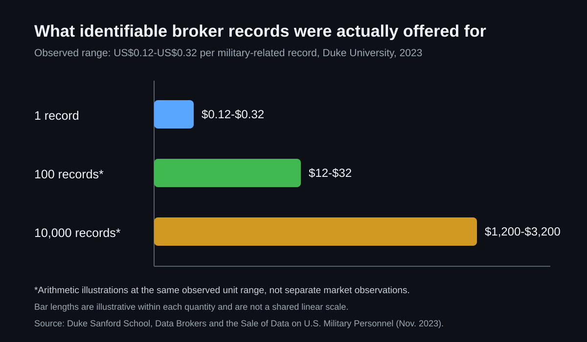

There is a version of you for sale that you have never met.

It may know the address where you sleep, the phone number you stopped using, the people who share your home, the clinic you visited, the places you worship, the products you buy, and the subjects you search when nobody else is in the room. It may be wrong about some of this. That does not make it harmless. A buyer can still act on a false conclusion.

I started this investigation with a number I had heard before: one person's data is supposedly worth almost **$300,000**. It sounds believable because our digital lives feel priceless. But after tracing primary reports, enforcement records, and actual broker purchases, I could not substantiate it.

The truth is stranger and, in my opinion, more disturbing. Individual records can be sold for pennies. The machinery that joins those pennies into a life can be immensely valuable. The harm to the person inside that life can be impossible to price.

## The $300,000 claim fails an evidence check

I found no accessible primary source showing that data brokers routinely pay, earn, or realize nearly $300,000 for one person's data. That does not prove the number has never appeared anywhere. It means the claim should not be repeated as fact without a source and a defensible method.

Four different things are often collapsed into one dramatic number:

1. **Transaction price:** what a buyer pays for a record, audience, or dataset.
2. **Corporate revenue:** what a platform or broker earns across products and millions of people.
3. **Economic value:** a modeled estimate of the benefit data creates for a company or consumer.
4. **Potential harm:** fraud, stalking, discrimination, manipulation, physical danger, or lost autonomy suffered by a person.

They are not interchangeable.

A [2023 Duke University study of data brokers selling information about U.S. military personnel](https://techpolicy.sanford.duke.edu/data-brokers-and-the-sale-of-data-on-us-military-personnel/) found identified or identifiable records advertised for roughly **US$0.12 to US$0.32 each**. Researchers could obtain sensitive information about active-duty service members, veterans, and their families, sometimes with minimal screening.

That observed market price does not measure what a person's safety is worth. It measures how cheaply a copy of a record could be acquired in that particular study.

<figure>
  
  <figcaption><strong>Figure 1.</strong> Duke researchers reported military-related records advertised at US$0.12 to US$0.32 each in 2023. The 100-record and 10,000-record figures are arithmetic illustrations at that unchanged unit range, not additional observed transactions. The bars do not share one linear scale. Download the <a href="/assets/data/data-broker-observed-prices.csv">underlying CSV data</a>.</figcaption>
</figure>

This is the paradox: **your record may be cheap because it is easy to copy, not because it is unimportant.**

## What is actually in the market

"Personal data" sounds bloodless. The enforcement record is not.

In its case against data broker [X-Mode Social and Outlogic](https://www.federalregister.gov/documents/2024/01/18/2024-00928/x-mode-social-inc-public-comment), the U.S. Federal Trade Commission alleged that location data could be used to identify visits to sensitive places, including medical and reproductive-health clinics, places of worship, domestic-abuse shelters, and addiction-recovery facilities. The FTC's 2024 order prohibited the companies from selling or sharing precise location data in important circumstances.

The FTC's case against [Gravy Analytics and Venntel](https://www.federalregister.gov/documents/2024/12/06/2024-28738/gravy-analytics-inc-analysis-of-proposed-consent-order-to-aid-public-comment) similarly concerned alleged collection, use, and sale of sensitive location information without adequate consent verification. The government's analysis says the alleged data tied people to sensitive locations and could expose consumers to discrimination, violence, emotional distress, and other harms.

Location is only one category. Broker profiles can include or infer:

- names, email addresses, phone numbers, and present or former homes;
- relatives, associates, household composition, and estimated age;
- device and advertising identifiers;
- purchases, browsing interests, searches, and app activity;
- income bands, debts, property, occupation, and financial vulnerability;
- movements and repeated visits to sensitive locations;
- health interests, pregnancy-related interests, and possible medical concerns;
- religion, political interests, ethnicity, and other demographic labels;
- military affiliation and other employment details.

Not every broker holds every field, and an inferred label is not necessarily true. The danger comes from scale, linkage, persistence, and the possibility that a buyer treats a probabilistic label as a fact.

## How fragments become a dossier

A phone app may collect a device identifier and location. A retailer records a purchase. A website sends advertising events. Public records reveal an address. A loyalty program connects a transaction to an email. A people-search service connects that email to relatives and prior homes.

Real-time advertising adds another path. The Irish Council for Civil Liberties reported in its [investigation of real-time bidding](https://www.iccl.ie/digital-data/americas-hidden-security-crisis/) that data about a U.S. person's online activity and location was broadcast in RTB systems hundreds of times per day on average. That is an estimate about broadcasts in an advertising ecosystem, not proof that every recipient stores or sells every event. It still shows the extraordinary frequency with which data can leave the screen where it originated.

The path is rarely a simple sale from App A to Buyer B. Data can pass through software development kits, advertising exchanges, analytics vendors, identity-resolution services, resellers, and downstream clients. A record can be copied, enriched, scored, and sold again. Removing it from one visible page does not call every copy home.

## AI changes what a pile of cheap records can do

Data brokers existed long before generative AI. Heading into 2027, the change is not that AI suddenly creates privacy risk. The change is that it can lower the cost of turning scattered data into something operational.

A capable system can help a user:

- join inconsistent names, addresses, devices, and accounts across large datasets;
- classify free text, URLs, purchases, and movements into sensitive categories;
- predict unobserved traits from correlated signals;
- rank people for targeting, scrutiny, exclusion, persuasion, or fraud;
- generate personalized messages using details from a profile;
- query millions of rows in ordinary language instead of specialist code;
- attempt reidentification by comparing an "anonymous" dataset with outside records.

The [NIST Generative AI Profile](https://www.nist.gov/publications/artificial-intelligence-risk-management-framework-generative-artificial-intelligence) identifies privacy risks including leakage or unauthorized disclosure of sensitive information, harmful inferences, and the difficulty of managing data across AI systems. NIST does not say that every model can identify every person. Neither do I. Reidentification and inference depend on the data's granularity, uniqueness, outside information, access controls, and the system being used.

There are two harms to remember. An AI-derived conclusion might be accurate and reveal something you never chose to disclose. Or it might be wrong and still influence how someone treats you.

By 2027, I expect the practical risk to be less about a villainous all-knowing model and more about ordinary organizations gaining inexpensive tools to search, summarize, score, and personalize data they already possess. That is a forecast, not an enacted fact. The underlying records and documented broker pathways are already here.

## Who buys, and why removal matters

Data has legitimate uses. Fraud prevention, credit decisions under regulated systems, marketing, research, and public-record access are not identical activities. The problem is that people often cannot see the full chain, correct false data, understand who received it, or meaningfully consent to future uses.

Potential buyers or users can include advertisers, insurers and financial firms within applicable rules, political campaigns, law enforcement or government contractors, investigators, employers using screening products, fraudsters, stalkers, and anyone willing to pay a people-search service. Availability, legality, and permitted use vary by dataset and jurisdiction.

Removal does not make you invisible. It can still be worthwhile because it adds friction:

- Fewer ready-made profiles can make impersonation and social engineering harder.
- Suppressing home addresses and relatives can reduce the convenience offered to stalkers or harassers.
- Deleting broker records reduces some inputs available for AI-assisted linkage and targeting.
- Correcting false profiles can reduce the chance that a bad inference keeps propagating.
- Repeating removal can limit the fresh copies that accumulate over time.

Privacy is not an on-off switch. Reducing exposure is useful even when perfect erasure is impossible.

## A practical removal plan

### 1. See what is already exposed

Search your exact name with your city, phone number, email addresses, current and old addresses, and common usernames. Check people-search results. Record URLs and screenshots for your own tracking, but do not republish the sensitive details.

### 2. Reduce collection at the source

Delete unused accounts and apps. Review location, contacts, microphone, photo, and background permissions. Prefer "while using" location access when an app genuinely needs it. Disable optional ad personalization and reset or limit advertising identifiers where your device allows it.

Downstream opt-outs cannot compensate for continuous upstream collection.

### 3. Use official universal tools where available

California residents can use the state's free [Delete Request and Opt-out Platform, or DROP](https://privacy.ca.gov/drop/). According to the state, DROP sends one request to more than 600 registered data brokers. Brokers began processing requests on August 1, 2026 and must access the system at least once every 45 days. Eligibility, exceptions, and implementation can change, so use the official site rather than an imitation.

Residents elsewhere should check their privacy regulator or attorney general for applicable access, correction, deletion, and sale opt-out rights.

### 4. Opt out of prominent people-search sites

Use each company's official privacy or suppression page. Keep a simple table with the broker, URL, request date, confirmation number, and recheck date. Provide no more identity documentation than required, and redact unrelated fields when the process permits it.

### 5. Protect the identifiers that cannot be deleted

Use unique passwords and multifactor authentication. Freeze credit where appropriate. Lock down mobile-carrier accounts with a PIN. Treat unexpected messages containing personal facts as untrusted. Accurate details make a scam persuasive; they do not make it legitimate.

### 6. Recheck

Broker ownership changes. Public records update. Apps collect again. A suppressed profile can reappear under a new address or spelling. Quarterly checks are reasonable for many people; those facing stalking, harassment, or public exposure may need a more frequent and safety-focused plan.

Paid removal services can save labor, but no credible service can guarantee permanent deletion from the entire ecosystem. Read what it covers, how often it rescans, what personal information it needs, and how it handles that information.

## What removal cannot promise

A removal request may hide a public profile without deleting every internal, archival, legally retained, or previously transferred copy. Public records may remain at their source. A recipient may be allowed to retain data. Identity verification can itself require sharing information. Rights differ by jurisdiction.

If you face an immediate safety threat, prioritize physical safety, account security, credit protection, and professional or local assistance. Do not spend the critical first hours completing dozens of broker forms.

## The real value of your data

I cannot prove your data is worth $300,000. I do not think anyone should use that figure without showing the math and the source.

What I can prove is more revealing: identifiable records about sensitive populations have been offered for cents. Regulators have documented markets involving precise location and intimate visits. Advertising systems can broadcast behavioral data at enormous frequency. AI can make those fragments easier to link, infer from, search, and use.

The buyer's price is not your value.

A list can be cheap and still expose a pregnancy, a medical concern, a religious practice, a military family, a frightened person seeking shelter, or the address where your children sleep. That is why removal deserves consideration. Not because it erases your existence, but because every unnecessary copy is another decision about your life that somebody else may get to make.

## Keep reading

- [How to delete your data from social media, dating apps, and Google](/posts/2026/11/21/how-to-delete-your-data-social-media-dating-apps-google/)
- [How to get your ISP to delete your data](/posts/2026/11/22/how-to-get-your-isp-to-delete-your-data/)
- [Why a survey link can become a quiet privacy and security problem](/posts/2026/11/21/redcap-survey-link-quiet-exploitation/)

## Sources

- Duke University Sanford School of Public Policy, [Data Brokers and the Sale of Data on U.S. Military Personnel](https://techpolicy.sanford.duke.edu/data-brokers-and-the-sale-of-data-on-us-military-personnel/) (November 2023).
- U.S. Federal Trade Commission, [X-Mode Social, Inc. proposed consent-order analysis](https://www.federalregister.gov/documents/2024/01/18/2024-00928/x-mode-social-inc-public-comment) (January 18, 2024).
- U.S. Federal Trade Commission, [Gravy Analytics proposed consent-order analysis](https://www.federalregister.gov/documents/2024/12/06/2024-28738/gravy-analytics-inc-analysis-of-proposed-consent-order-to-aid-public-comment) (December 6, 2024).
- Irish Council for Civil Liberties, [America's hidden security crisis](https://www.iccl.ie/digital-data/americas-hidden-security-crisis/) (May 2022).
- National Institute of Standards and Technology, [Artificial Intelligence Risk Management Framework: Generative Artificial Intelligence Profile](https://www.nist.gov/publications/artificial-intelligence-risk-management-framework-generative-artificial-intelligence) (July 2024).
- California Privacy Protection Agency, [Delete Request and Opt-out Platform](https://privacy.ca.gov/drop/) (accessed November 26, 2026).
